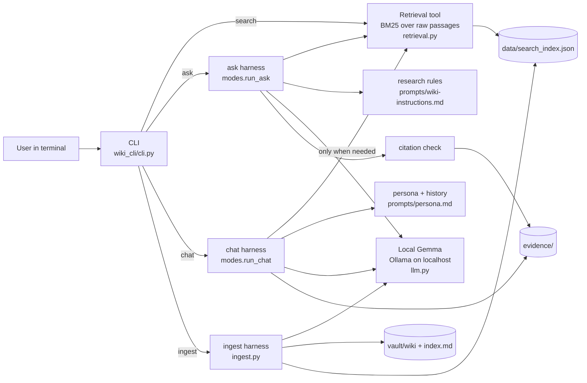
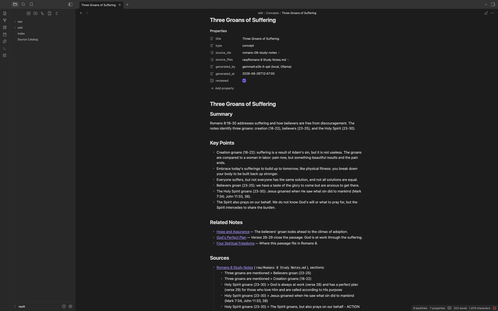
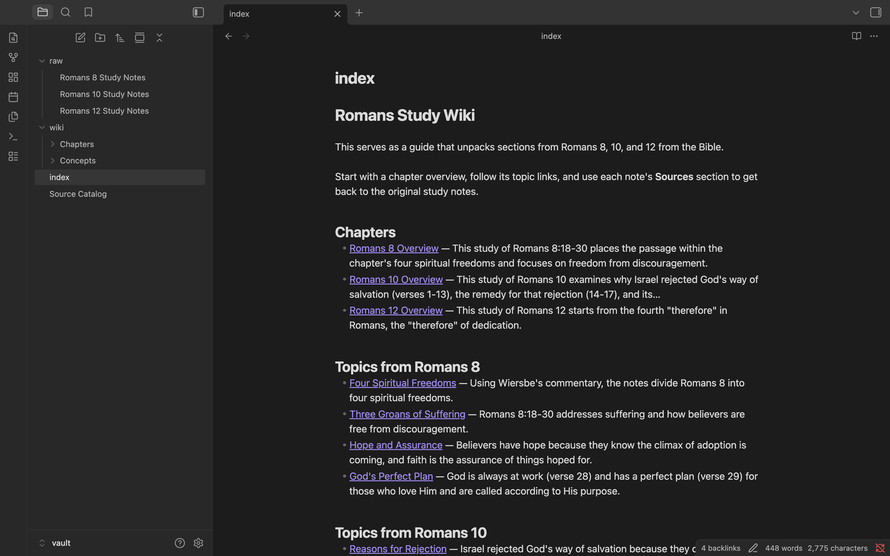
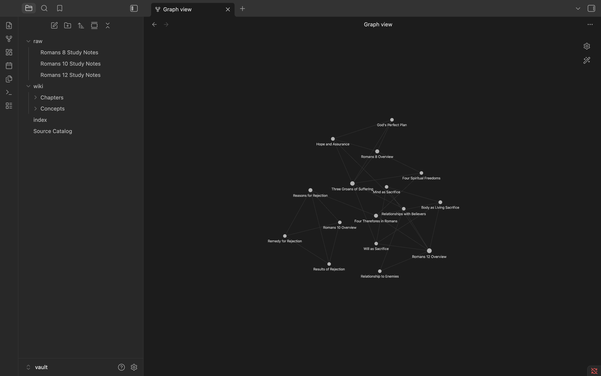

# Romans Study Wiki: Personal Wiki with Local Gemma + RAG

**Assignment 4, Class 5 (From Zero to AI Agents).** This project is a personal wiki built from my
own Bible study notes, with my own command-line harness around a **local Gemma model**. It
has three modes: **chat** (a warm study companion), **ask** (neutral answers grounded in the
notes, with citations) and **search** (the original passages, with no answer generated). After setup it runs fully
offline.

> This serves as a guide that unpacks sections from Romans 8, 10, and 12 from the Bible.

**Jump to:** [Setup](#setup-and-device) · [Commands](#cli-commands) · [Architecture](#architecture) ·
[Design choices](#design-choices) · [Evidence](#evidence) · [Reflection](#reflection)

| Evidence | Link |
|---|---|
| CLI and harness code | [`wiki_cli/`](wiki_cli/) and the launcher [`wiki`](wiki) |
| Wiki (Obsidian vault) | [`vault/index.md`](vault/index.md) · [`vault/wiki/`](vault/wiki/) · [`vault/raw/`](vault/raw/) · [Source Catalog](vault/Source%20Catalog.md) |
| Four ask-mode evidence cards | [Test 1](evidence/cards/test-1-three-groans.md) · [Test 2](evidence/cards/test-2-purpose-of-the-law.md) · [Test 3](evidence/cards/test-3-romans-8-1-therefores.md) · [Test 4](evidence/cards/test-4-unanswerable-author.md) |
| Chat and search mode checks | [evidence/cards/mode-checks.md](evidence/cards/mode-checks.md) |
| Offline demonstration | [terminal log](evidence/offline-run/terminal-log.txt) · [screen recording (720p, 4.5 min)](evidence/offline-run/offline-demo.mp4) |
| Obsidian screenshots | [open note](evidence/screenshots/1-open-note.png) · [index and page list](evidence/screenshots/2-index-and-page-list.png) · [graph](evidence/screenshots/3-graph-view.png) |
| Wiki review and ingestion history | [review log](evidence/ingest/review-log.md) · [ingest runs](evidence/ingest/) · [re-ingest duplicate check](evidence/ingest/reingest-duplicate-check.txt) |

---

## Purpose and sources

The wiki covers three of my small-group Bible study notes. Each one follows Wiersbe's commentary
and a group discussion.

| Raw source (unchanged) | Original file | What it covers |
|---|---|---|
| [`vault/raw/Romans 8 Study Notes.md`](vault/raw/Romans%208%20Study%20Notes.md) | `Romans 8_18 - 30.docx` | Four spiritual freedoms, the three groans, adoption, God's plan |
| [`vault/raw/Romans 10 Study Notes.md`](vault/raw/Romans%2010%20Study%20Notes.md) | `Romans 10.docx` | Israel's rejection: reasons, remedy, results |
| [`vault/raw/Romans 12 Study Notes.md`](vault/raw/Romans%2012%20Study%20Notes.md) | `Romans 12.docx` | The four "therefores", dedication (body, mind, will), relationships |

**How the sources were prepared.** Before anything was added to the vault:
1. **Privacy:** I removed the group prayer requests, which included other members' names and
   personal details, in Word.
2. **Conversion:** [`tools/convert_docx.py`](tools/convert_docx.py) converted each `.docx` to
   Markdown once. The words are unchanged and only the bullet formatting differs; I checked this
   line by line against macOS `textutil`. Markdown was chosen because Obsidian can't open `.docx`
   (so source links would break) and because Word files carry author metadata.

**How the originals connect to the generated pages.** Every wiki page has `source_ids` and
`source_files` properties and a **Sources** section that links to the raw note and names the
exact sections it came from. The [Source Catalog](vault/Source%20Catalog.md) maps each source ID
(e.g. `romans-08-study-notes`) to its raw note, its original filename, a SHA-256 hash, and every page it produced.

---

## Setup and device

### Device (measured on the machine used for every run)
| | |
|---|---|
| OS | macOS 14.3 (23D56) |
| Chip | Apple M1 (8 cores), integrated GPU |
| Memory | 8 GB unified memory (shared CPU/GPU), no dedicated VRAM |
| Available memory | 31–35% free system-wide (`memory_pressure`) during runs |
| Free disk | 11 GB after the model download |
| Runtime | Ollama 0.34.3 (llama.cpp `llama-server` backend, Metal) |
| Python | 3.14.7, **standard library only** (no `pip install` needed) |

### Model
| | |
|---|---|
| Model | **Gemma 4 E2B, instruction-tuned** |
| Exact identifier | `gemma4:e2b-it-qat` (Ollama digest `07ea59a47401`) |
| Quantization | **Q4_0**, quantization-aware trained (QAT) |
| Download size | 4.3 GB · Ollama reports 4.6B parameters; Gemma's model card describes E2B as 2.3B *effective* parameters, with extra embedding tables that also use memory |
| Context requested | 8,192 tokens (`num_ctx`) |
| Official source | [ollama.com/library/gemma4](https://ollama.com/library/gemma4) (tag `e2b-it-qat`); model family docs at [ai.google.dev/gemma](https://ai.google.dev/gemma) |

**Why this model fits my computer** (my words):
> The model fits my Mac because the model measured 4.8 - 4.97 GB while running. The answers took about 2-7 seconds as well.

Supporting detail: the class guidance recommends starting with quantized E2B on an 8 GB Apple
Silicon Mac. I didn't use Ollama's default `gemma4:e2b` tag because it's a 7.2 GB Q4_K_M
download. E4B was not tried: its roughly 4.5 GB load estimate alone, plus context and the
runtime, would leave little of the 8 GB for macOS.

### Measured memory and response time (offline run, 2026-09-26)
| What | Time | Model process memory |
|---|---|---|
| Model load (first call; measured in development runs) | 8.2–8.5 s | |
| Ingest: Gemma reads one source and proposes topics | 25.6 s / 30.5 s / 28.5 s (Romans 10 / 12 / 8) | 4.70–4.76 GB |
| Ingest: all 3 sources (`--force`, offline) | **85.5 s** total | peak 4.79 GB |
| First full ingest with Gemma linking 12–14 pages (online, runs 2–3) | 141–156 s | |
| Ask: one RAG answer | **2.0–6.6 s** (4 tests) | 4.78–4.86 GB |
| Whole offline session (after chat) | | **4.94 GB, peak 4.97 GB** |

**How memory was measured.** I used `phys_footprint` from macOS `footprint` for Ollama's
`llama-server` process, in [`llm.memory_snapshot()`](wiki_cli/llm.py). Ollama's own `/api/ps`
reports only **1.67 GB**, and process RSS reports about 0.1 GB, because on Apple Silicon the GPU
buffers in unified memory don't count toward RSS. My first ingest logs recorded the misleading
RSS number, and I corrected the method before the offline run.

### Install and run (exact steps)
While **online**, one time only:
```bash
brew install ollama                      # or the Ollama app from ollama.com
ollama serve &                           # start the local server (skip if the app is running)
ollama pull gemma4:e2b-it-qat            # 4.3 GB, stored in ~/.ollama/models
git clone https://github.com/jordandking213-afk/personal-wiki-gemma-rag.git
cd personal-wiki-gemma-rag
```
Python 3 is required (tested with 3.14.7), and the code uses only the standard library. After this nothing
needs the internet. Model weights are not committed; the pull command above is the official
source.

To rebuild the sources from Word files (not needed to run the project, since the Markdown is committed):
```bash
python3 tools/convert_docx.py "Romans 10.docx" "vault/raw/Romans 10 Study Notes.md"
```

---

## CLI commands

The launcher `./wiki` runs `python3 -m wiki_cli`. Local execution is the default and the only mode.

| Command | What it does | Model needed? |
|---|---|---|
| `./wiki --help` | Commands, modes, configuration, requirements | no |
| `./wiki ingest vault/raw` | Reads the raw notes, has Gemma organize them into topic pages, links the pages, rebuilds `index.md` and the search index. Unchanged sources are skipped | yes |
| `./wiki ingest vault/raw --force` | Re-runs Gemma on unchanged sources. Reviewed pages are kept, and Gemma's new draft is saved to `data/drafts/` | yes |
| `./wiki search "living sacrifice"` | Original passages with file path, section and BM25 score. **No answer is generated** | **no** |
| `./wiki ask "Where …?"` | Standalone, neutral answer with `[S#]` citations, or `INSUFFICIENT EVIDENCE` | yes |
| `./wiki chat` | Study companion with conversation memory. Inside chat: `/notes <topic>`, `/reset`, `/exit` | yes |

Every `search`, `ask` and `chat` run is saved to `evidence/<mode>/` as Markdown and JSON,
unless you pass `--no-save`. Errors are explicit, for example:
```
Error: Cannot reach the local Ollama server at http://localhost:11434.
  Fix: start it with `ollama serve` (or open the Ollama app), then retry.
Error: Model 'gemma4:e2b-it-qat' is not installed locally.
  Fix (while online): ollama pull gemma4:e2b-it-qat
Error: No such file or folder: vault/nope
Error: online mode is not implemented in this project. Local mode is the default …
```

---

## Architecture



The five parts are separate:

- **Model:** local Gemma behind Ollama's HTTP API on `localhost:11434` ([`llm.py`](wiki_cli/llm.py)).
  It only sees the text the harness sends. It never reads files, remembers sessions or calls tools.
- **Retrieval tool:** [`retrieval.py`](wiki_cli/retrieval.py) is BM25 keyword search that I wrote
  (about 80 lines) over passages split from `vault/raw/`. It returns passages with their source path and
  section, and never generates text. **Search mode is this tool on its own.**
- **RAG workflow:** in ask mode: retrieve, put the passages in the prompt, have Gemma answer
  from them, then check the citations. RAG adds context at answer time; it doesn't train the model.
- **CLI:** [`cli.py`](wiki_cli/cli.py) parses the command and flags, and dispatches.
- **Harness:** everything around the model. It selects the mode, loads that mode's
  instructions, manages chat history, decides whether to retrieve, builds prompts, calls Gemma,
  checks citations, handles errors, and saves outputs ([`modes.py`](wiki_cli/modes.py),
  [`ingest.py`](wiki_cli/ingest.py), [`evidence.py`](wiki_cli/evidence.py)).

### Tracing one command: `./wiki ask "Why couldn't the Jewish law bring Israel to salvation?"`
1. **`wiki`** (shell launcher) runs `python3 -m wiki_cli ask "…"`.
2. **[`cli.main`](wiki_cli/cli.py)** parses the arguments. The `ask` subcommand maps to `cmd_ask`,
   which rejects `--mode online` and calls `modes.run_ask`.
3. **[`modes.run_ask`](wiki_cli/modes.py)** prints the header (`ask · execution: local · model: …`).
   It does **not** load chat history or the persona.
4. **Retrieval:** `retrieval.search(question, k=5)` loads `data/search_index.json`, tokenizes
   the question (`jewish, law, bring, israel, salvation`) and scores every passage with BM25.
   Here it returned `Romans 10 Study Notes#1` (9.05) and `#3` (3.85).
5. **Prompt assembly:** the system message is `prompts/wiki-instructions.md` (sources only, cite
   `[S#]`, no personality, an exact `INSUFFICIENT EVIDENCE` line). The user message is
   `SOURCES:` followed by each passage labeled `[S1] path — section`, then `QUESTION: …`.
6. **Model call:** `llm.chat()` sends a POST to `localhost:11434/api/chat` (temperature 0.1,
   `num_ctx` 8192, thinking off) and streams tokens to the terminal as they arrive.
7. **Citation check:** `check_citations()` parses `[S1]`, `[S1, S4]` and similar. It fails the answer if a
   cited number wasn't provided, or if a non-refusal answer has no citations. Then it prints each
   cited source's path and section.
8. **Saved output:** `evidence.save()` writes `evidence/ask/<time>-<slug>.md` and `.json`,
   containing the question, the retrieved passages, the model identity, the answer, the citation
   check, the timing and the memory snapshot.

### How each mode is kept separate
| | search | ask | chat |
|---|---|---|---|
| Instructions | none | `wiki-instructions.md` (neutral research rules) | `persona.md` (warm, supportive teacher) |
| Conversation context | none | **none**: each question is independent | last 6 turns |
| Retrieval | always (it *is* retrieval) | always, top 5 passages | **only when needed** (see below) |
| Model call | **never** | yes, temperature 0.1 | yes, temperature 0.6, streamed |
| Citations | shows paths | required, checked | required when notes are used, checked |
| Saved to | `evidence/search/` | `evidence/ask/` | `evidence/chat/` (whole session) |

**When chat retrieves** ([`decide_retrieval`](wiki_cli/modes.py)):
1. `/notes <topic>` always retrieves.
2. Conversational turns never retrieve, for example greetings, "what can you help me with?", or
   "make that shorter / rewrite / try again."
3. Otherwise it retrieves if the message names the study (Romans, a chapter or verse such as
   `8:28`, "notes", "study", "Bible"), **or** if at least 50% of its content words appear in the
   notes and the top BM25 score is at least 1.5.

The harness prints its decision on every turn, e.g.
`[no notes lookup (conversational turn …)]`. Chat history is conversation context, not source
material: ask mode never sees it.

---

## Design choices

**Passages.** The notes are outlines, so [`passages.py`](wiki_cli/passages.py) parses them as a tree.
Each plain line starts a section, and bullets nest under it by indentation. A section becomes one
passage unless it's longer than **120 words**, in which case it's split at its child bullets.
Each piece keeps its full breadcrumb, e.g. `Three groans are mentioned > Believers groan (23-25)`.
This produced **18 passages** of 15–117 words, each with a source path and section.

**How much text Gemma sees.** Ask and chat send the **top 5 passages**, about 700 words, plus the
instructions, well inside the 8,192-token context. Ingest sends one whole source note at a time
(219–671 words). The whole wiki is never sent at once.

**Retrieval.** BM25 keyword search with a stopword list and light stemming (so "groans" matches
"groan"). I chose it over embeddings because the corpus is small (18 passages), it needs no
second model download, it is fully offline, and a score can be explained by reading it. `TOP_K` was raised from 4 to 5 after
inspecting retrieval for test 1 ([retrieval-tuning.md](evidence/retrieval-tuning.md)).

**Research rules vs. persona.** These are kept in separate files. Ask uses
[`prompts/wiki-instructions.md`](prompts/wiki-instructions.md): only the sources, a citation for
every claim, no outside knowledge "even if you are confident it is true," and an exact
insufficient-evidence line. Chat uses [`prompts/persona.md`](prompts/persona.md): a warm, kind,
supportive teacher, with an honest list of what it can and can't do. It labels its own ideas as
suggestions and never invents facts about the user.

**Model settings.** Thinking is turned off (`think: false`) to keep answers short and fast. I
didn't compare against thinking mode. Ask uses temperature 0.1 so it follows the
rules; chat uses 0.6 to sound natural. Ingestion uses Ollama's JSON-schema output (`format`) so
Gemma's topic lists always parse. `minItems: 3, maxItems: 5` was added after run 1 produced 8 thin topics for
Romans 12.

**How ingestion works** ([`ingest.py`](wiki_cli/ingest.py)):
1. Split the source into numbered passages.
2. Gemma writes an overview and 3–5 topics (title, summary, key points, and which passages each came from).
3. **Coverage check:** passages that no topic used go back to Gemma for up to 2 additional
   topics, and anything still uncovered is reported as a warning.
4. The harness turns titles into short, filename-safe names, stores the structured content in
   `data/pages.json`, and records the source in `data/manifest.json`.
5. Gemma suggests related notes, and only titles that actually exist are kept.
6. The harness renders the pages, `index.md`, the Source Catalog and the search index.

**Naming and folders.** Notes are named for their subject in 2–6 words (`Three Groans of
Suffering.md`, `Four Therefores in Romans.md`), and the first heading matches the filename. The
vault has `raw/` for the unchanged originals and `wiki/Chapters/` for one overview per study.
`wiki/Concepts/` holds one note per idea. `index.md` is the landing page, grouped by chapter
with one-line descriptions. Machine IDs, hashes and original filenames live only in properties
and the Source Catalog. Code, the index, logs and test answers are all **outside** `vault/`.

**Human review.** I checked every generated page against the raw notes and corrected it with
[`tools/apply_review.py`](tools/apply_review.py). The [review log](evidence/ingest/review-log.md)
has the before and after text for each fix. Examples of what Gemma got wrong: it wrote "Israel
*was rejected*" (the notes are about Israel rejecting God's way) and "Isaac *died* in obedience"
(the notes say a ram took his place). It said the remedy "*involves a missionary program*," stated
predestination as settled (the notes mark it "???"), and turned my reflection questions into
commands. The review also renamed 5 pages, merged 2 duplicate notes about enemies, and replaced
Gemma's vague "hub" links with links whose reasons come from the notes. The raw evidence was
never edited.

**Re-ingestion without duplicates.** `data/manifest.json` records each source's hash and the page
titles it produced.
- An **unchanged** source is skipped.
- `--force` on an unchanged source makes Gemma reuse the exact recorded titles; any other title
  is mapped to the closest recorded one. The **reviewed** text is kept, and Gemma's new draft is saved to
  `data/drafts/` for comparison.
- A **changed** source is regenerated under the same titles and marked unreviewed.

Checked: 16 pages before and 16 after a normal re-ingest plus a forced re-ingest
([log](evidence/ingest/reingest-duplicate-check.txt)), and again offline with all 3 sources forced.
Gemma's forced re-ingest draft of Romans 10 still said "missionary program," which shows why reviewed
text takes priority.

**Obsidian.** Open `vault/` itself as the vault, not the whole repo. The graph screenshot uses the
filter **`path:wiki/`** with Attachments off (saved in
[`vault/.obsidian/graph.json`](vault/.obsidian/graph.json)). All `[[links]]` resolve to exactly
one file (checked with a script), and every Concept and Chapter heading matches its filename.

---

## Evidence

All results below come from **one offline session on 2026-09-26, 14:02–14:06**. Wi-Fi was off,
and the script confirmed `https://ollama.com` was unreachable. Ollama was restarted, and everything used
`gemma4:e2b-it-qat` on the M1 described above. The session was driven by
[`tools/offline_demo.sh`](tools/offline_demo.sh), and its full output is in the
[terminal log](evidence/offline-run/terminal-log.txt) and the
[screen recording](evidence/offline-run/offline-demo.mp4). Test questions and expected passages
were written **before** retrieval was built, in [`tests/questions.md`](tests/questions.md),
which is outside the vault so retrieval can't find the answer key.

### Ask-mode tests (local, offline)
| # | Question | Expected source | Retrieved? | Answer | Result |
|---|---|---|---|---|---|
| 1 | What are the three groans in Romans 8:18-30? | Romans 8: creation / believers / Holy Spirit | ✅ all three (S3, S5, S1) | Lists all three with correct verse ranges, each cited | **PASS** ([card](evidence/cards/test-1-three-groans.md)) |
| 2 | Why couldn't the Jewish law bring Israel to salvation? *(worded differently)* | Romans 10: "Law was a signpost…" | ✅ rank 1 | Quotes the signpost line exactly, plus "obeyed in the heart" [S1] | **PASS** ([card](evidence/cards/test-2-purpose-of-the-law.md)) |
| 3 | How does Romans 8:1 fit into the "therefore" passages…, and what does Romans 8 say that freedom looks like? | Romans 12 (therefores) + Romans 8 (freedoms) | ✅ ranks 1 and 2 | "8:1 is the therefore of assurance" [S1], plus the four freedoms [S2] | **PARTIAL** ([card](evidence/cards/test-3-romans-8-1-therefores.md)) |
| 4 | Who wrote the book of Romans? *(not in the notes)* | none | only weak matches (top BM25 1.70) | `INSUFFICIENT EVIDENCE…` It didn't answer "Paul" from general knowledge | **PASS** ([card](evidence/cards/test-4-unanswerable-author.md)) |

**Test 3, what went wrong:** both sources were retrieved and cited, but the answer only says *what*
8:1 is, not *how it fits* among the four therefores (3:20 → 5:1 → 8:1 → 12:1), even though S1
contained all four. It also wrote "freedom from separation," while the notes only say
"(No Separation)."

### Chat and search mode checks (local, offline)
Details and the full transcript are in [mode-checks.md](evidence/cards/mode-checks.md).

| Check | Result |
|---|---|
| "what can we do?" / "what can you help me with?" | ✅ Explained capabilities, no notes lookup, no refusal |
| 3-step small-group plan on Romans 12 | ⚠️ Looked up notes, cited Romans 12 passages. Two citations overstate their passage |
| "make that shorter" | ✅ Used the conversation, no lookup, condensed the plan |
| "our study group meets on Tuesdays" | ❌ Unneeded notes lookup ("study" keyword), and a citation pointed at the wrong passage while the checker reported OK |
| `search "living sacrifice"` | ✅ 3 original passages with paths, no model call |
| `ask "When does the study group meet?"` after telling chat | ✅ `INSUFFICIENT EVIDENCE`: the chat claim wasn't treated as a source |

### Obsidian screenshots
| Open note with sources and related links | Index and page list | Graph (`path:wiki/`, attachments off) |
|---|---|---|
|  |  |  |

To trace one note back to its evidence: start at `index.md`, open [Romans 8 Overview](vault/wiki/Chapters/Romans%208%20Overview.md),
then [Three Groans of Suffering](vault/wiki/Concepts/Three%20Groans%20of%20Suffering.md), then its related
note [Hope and Assurance](vault/wiki/Concepts/Hope%20and%20Assurance.md). That note's Sources section
leads back to [Romans 8 Study Notes](vault/raw/Romans%208%20Study%20Notes.md), section "Believers groan (23-25)."

### Earlier runs and failures (kept, not replaced)
- [Ingest run 1](evidence/ingest/run-1-title-bug/): apostrophes broke titles (`Israel S Rejection Reasons`)
  and Romans 12 got 8 thin topics. Fixed title cleaning and capped topics at 5.
- [Ingest run 2](evidence/ingest/run-2-before-coverage-check/): Gemma skipped the four
  "therefores" and the Spirit's intercession. Added the coverage check.
- [Ingest run 3](evidence/ingest/run-3-gemma-before-review/): Gemma's unreviewed output before the
  [human review](evidence/ingest/review-log.md).
- [Retrieval tuning](evidence/retrieval-tuning.md): test 1 missed a passage at `TOP_K=4`, and chat's
  first lookup rule would have searched the notes for "dinner recipe."
- [Earlier attempts](evidence/earlier-attempts/): the demo script was started twice before
  the recorded run. Those outputs are kept but aren't covered by the offline log.

---

## Reflection

**Limitation:**
> Gemma skipped content during ingestion. In other words, when my own notes were converted into wiki pages, some of my ideas were left out entirely.

**Improvement:**
> An improvement I can try is to have "study" not be pulled into the lookup keywords, as the last comment on the offline test made the chat search in Romans 8 when all it needed to do was acknowledge the comment.

Supporting evidence for both. In ingest run 2 ([pages](evidence/ingest/run-2-before-coverage-check/pages.json)),
no page covered the four "therefores" from Romans 12 or the Holy Spirit praying on our behalf
(from "Holy Spirit groans (23-30)"). The coverage check recovered them in run 3, and one passage was still reported
uncovered in the offline re-ingest. For the chat keyword: with "study" removed, "Just so you know,
our study group meets on Tuesdays" no longer triggers a lookup, because only 40% of its words appear
in the notes, below the 50% rule. I haven't made that change, so the recorded offline results
stay exactly as they ran.

**Other known limitations:**
- The citation check verifies that `[S#]` numbers exist, **not** that the passage supports the claim
  (see the mode checks).
- Chat keeps earlier turns' notes in its history, so `[S1]` can mean different passages on different
  turns.
- BM25 matches words, not meaning. It found test 2 because "law", "Israel" and "salvation"
  appear in the notes; a paraphrase that shares no words would miss.
- Gemma's related-note links were too generic to keep, so the final links were curated by hand.

## Optional online mode
Not implemented. `--mode online` exits with an explanation. Nothing leaves the machine: the only
network traffic is to Ollama on `localhost`.

## Repository layout
```
wiki, wiki_cli/        CLI launcher and harness (standard-library Python)
prompts/               persona.md (chat) · wiki-instructions.md (ask research rules)
vault/                 Obsidian vault: raw/ (unchanged sources), wiki/, index.md, Source Catalog.md
data/                  machine files: manifest, page data, search index, drafts, ingest logs
tests/questions.md     four test questions + expected evidence (outside the vault)
evidence/              evidence cards, saved runs, offline log + recording, screenshots, review log
tools/                 docx converter, review script, offline demo script
```
